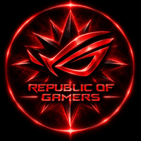
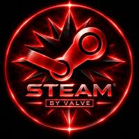

<p align="center"></p>

<h1 align="center"> 999BORAT999 </h1>
<h3 align="center">The Don of the Terminal · Gamer · Hacker by Night</h3>

<p align="center">
  
</p>

---

### 🎩 Who runs this repo
```bash
$ whoami
999BORAT999

$ cat about.txt
> Boss of my own code empire
> Gamer first, hacker second, sleeper never
> Building, breaking, learning – every single night
```

### 💼 The family business
<!-- Delete what you don't use, add what you do -->


### 🖥️ The setup
<p align="center">
  
  &nbsp;&nbsp;&nbsp;
  
  &nbsp;&nbsp;&nbsp;
  
</p>

### 🎮 Off-duty
- 🎯 Grinding games when the code compiles
- 🔐 Into cybersecurity & CTF challenges
- 🌃 Most commits happen after midnight

### 📒 The books (family ledger)
```diff
+ Bugs eliminated ............. 999
+ Hennessy consumed ........... too many
+ wifes fucked ................... all of them
- Bugs that survived .......... 0 (they know too much)
- Hours of sleep .............. classified
! Debts owed to Stack Overflow  incalculable
```

---
<p align="center"><i>"Respect the code, and the code will respect you."</i> 🦁</p>
